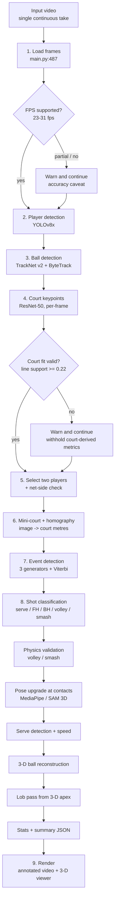
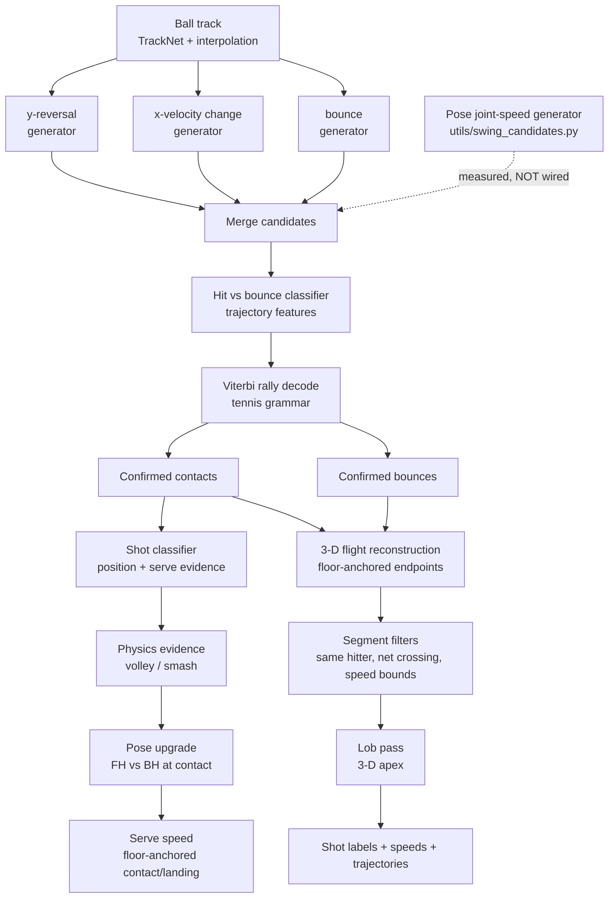

# Tennis-Vision pipeline

A code-level diagram of the default single-camera pipeline in `Tennis-Vision`. It follows the actual `[1/9]`–`[9/9]` stages in `main.py`, not just the README.

> Scope: single continuous broadcast/elevated take, 23–31 fps validated. This is **not** a technique-assessment pipeline and **not** multi-camera.

## High-level flow



**Important branches:** a failed court gate does not stop the run. It withholds court-derived measurements, and serve speed and 3-D reconstruction are skipped. A failed player-selection check also warns rather than aborting. The output video, CSV, and JSON are still written with the warning attached.

## Event and shot detail



The dashed node is deliberate: `utils/swing_candidates.py` implements a fourth, pose-based contact generator, but its measured result was indistinguishable from ordinary player movement, so it is not in the default path.

## Stage-by-stage code map

| Stage | Log line | Main code | What it does | Failure behavior |
|---|---|---|---|---|
| 1. Load + FPS | `[1/9]` | `main.py:487-536`, `utils/fps_support.py:84-92` | Read frames, read header FPS, classify 23–31 / 18–50 / outside. | Warns; still runs with an accuracy caveat. |
| 2. Players | `[2/9]` | `trackers/player_tracker.py` | YOLOv8x tracking; optional detection stubs. | Tracking gaps handled later by selection/coverage checks. |
| 3. Ball | `[3/9]` | `trackers/tracknet_ball_tracker.py`, `trackers/ball_tracker.py` | TrackNet v2 (or YOLO + ByteTrack), then interpolation. | Reports detection coverage and longest gap. |
| 4. Court | `[4/9]` | `court_line_detector/court_line_detector.py:28,85` | 14-keypoint ResNet-50; per-frame or frame-0; smoothing. | `utils/court_validity.py:64` gate; invalid fit withholds metrics. |
| 5. Players → 2 | `[5/9]` | `utils/player_selection.py` | Clip-level selection, net-side sanity check. | `failed` / `degraded` warning; continues. |
| 6. Mini-court | `[6/9]` | `mini_visual_court/mini_court.py` | Layout, homography, image→court projection, Kalman smoothing. | Per-frame homography fallback is logged. |
| 7. Events | `[7/9]` | `utils/hit_bounce_classifier.py`, `utils/rally_decode.py:205` | 3 generators → hit/bounce classifier → Viterbi decode. | Missed contacts remain missed; recall ≈72%. |
| 8. Shots | `[8/9]` | `utils/shot_classifier.py`, `utils/shot_physics.py`, `utils/pose_shot_classifier.py` | Serve evidence, FH/BH/volley/smash rules, physics validation, pose upgrade. | Pose can fail; label falls back to position rule. |
| 8b. Serve speed | inside stage 8 | `utils/serve_detector.py`, `utils/serve_speed.py`, `utils/serve_landing.py` | Floor-anchored contact→landing speed. | Refused if landing is not observed or court fit is invalid. |
| 8c. 3-D | inside stage 8 | `utils/trajectory_3d.py` | Closed-form ball flight between floor-anchored events; segment validity filters; lob pass. | Skipped if court fit is invalid; bad segments rejected. |
| 9. Render | `[9/9]` | `main.py:1483+` | Annotated video, CSV, summary JSON, 3-D HTML viewer, logs. | Always outputs; warnings carried in JSON. |

## What comes out

| Output | Produced by | Contains |
|---|---|---|
| Annotated video | `main.py` stage 9 | Player/ball boxes, court keypoints, mini-court, stats panel, shot labels. |
| CSV | `save_stats` (`main.py:1453`) | Per-frame player stats, shot counts, speeds, averages. |
| Summary JSON | `save_stats` | Court fit, calibration/fallback counts, FPS support, rally decoding diagnostics, player-selection quality, ball coverage, shot types, serve speed, 3-D trajectories, warnings. |
| 3-D viewer HTML | `utils/viewer_3d.py` | Self-contained ball-flight scene with evidence cards. Single-camera reconstruction only. |
| Log | `setup_logging` | Per-stage diagnostics and explicit refusal reasons. |

## Gates and refusals

| Gate | Code | Effect |
|---|---|---|
| FPS support | `utils/fps_support.py` | Outside 23–31 fps: warning, not refusal. |
| Court validity | `utils/court_validity.py:64` | Invalid fit: “speeds, distances and mini-court positions are NOT measurements”; serve speed and 3-D skipped. |
| Player selection | `utils/player_selection.py` | Same-side or low-coverage selection: warning in log/JSON. |
| Homography fallback | `mini_visual_court/mini_court.py` | Per-frame failure falls back to nearest-keypoint; warning includes frame count. |
| 3-D segment filters | `main.py:1290-1390` | Rejects bounce-to-bounce, same hitter at both ends, no net crossing, impossible speed. |
| Pose availability | `utils/pose_estimator.py` | Missing/ambiguous pose keeps the position-based shot label. |
| SAM 3D availability | `utils/sam3d_pose.py` | Requested but unavailable: warns loudly and falls back to MediaPipe. |

## The pipeline in one line

```text
video
  -> FPS check
  -> players + ball + court keypoints
  -> court-validity gate
  -> select two players
  -> homography + Kalman smoothing
  -> contacts/bounces (3 generators + Viterbi)
  -> shot labels (rules + physics + pose)
  -> serve speed + 3-D ball flight
  -> annotated video + CSV + JSON + 3-D viewer
```

## What this pipeline is not

- **Not multi-camera.** The 3-D viewer renders one single-camera reconstruction from different viewpoints.
- **Not arbitrary-viewpoint.** Per-frame keypoints handle pan/tilt/zoom; ground-level phone video fails the court gate.
- **Not technique analysis.** Pose is used only at contact frames to upgrade forehand/backhand. There is no per-frame skeleton, racket tracking, joint-angle time series, rubric, score, or coaching feedback.
